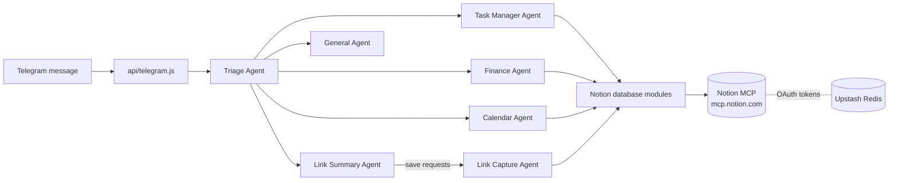

# Notion Telebot

A personal assistant you message on **Telegram** that saves your tasks, expenses, calendar events and links into **Notion**.

It runs as a serverless function on **Vercel**. **OpenAI Agents SDK** routes each message to a specialist agent, and every write reaches Notion through the hosted **Notion MCP** server.

| You send | It saves to Notion |
|---|---|
| `add a task to call Alex tomorrow` | **Tasks**: "Call Alex", due tomorrow |
| `spent $12 on lunch` | **Finance**: lunch, 12, food |
| `dinner with Sam this saturday` | **Calendar**: "Dinner with Sam", next Saturday |
| `save this https://github.com/openai/openai-node` | **Links**: title, summary and URL |
| `https://example.com` | Nothing; it replies with a summary |
| `hello` | Nothing; it chats normally |

---

## Contents

- [How it works](#how-it-works)
- [Using the bot](#using-the-bot)
- [Project structure](#project-structure)
- [Setup](#setup)
- [Scripts](#scripts)
- [Testing](#testing)
- [Troubleshooting](#troubleshooting)
- [Limitations](#limitations)

---

## How it works



1. **Telegram** sends each message to the Vercel webhook at `/api/telegram`. The webhook checks Telegram's secret token header, answers Telegram straight away, and finishes the turn in the background. Messages from users not on the allowlist are ignored, and retried updates are only handled once.
2. The **Triage Agent** decides what kind of request it is and hands it to one specialist agent. It sees the chat's last 10 messages (kept in Redis for an hour), so an answer to a clarifying question keeps its context.
3. **Specialists only see small, validated tools**: `create_task`, `add_expense`, `create_calendar_event` and `save_link_summary`. These tools check inputs (dates, amounts, categories, URLs) before anything is written.
4. **The tools call database modules**, which turn the input into a Notion MCP `notion-create-pages` call. Agents never get raw Notion access.
5. **Notion MCP uses OAuth.** The bot's sign-in is stored in **Upstash Redis**, so every stateless Vercel function can reuse and refresh it.
6. **The specialist's reply** goes back to the same Telegram chat.

---

## Using the bot

**General rules**

- Each message is handled **on its own**, and the bot doesn't remember earlier messages. If it asks you a question, reply with the **whole request** again, including the missing detail.
- Send **one request per message**.
- The bot can only **create** entries. It can't list, edit or delete them.
- Relative dates like "today" and "tomorrow" use **Singapore time** (`Asia/Singapore`).

| Database | Say something like | Rules |
|---|---|---|
| **Tasks** | "add / create / remember a task to…", "remind me to…" | Due dates: `today`, `tomorrow` or `YYYY-MM-DD`. Any other date phrase creates the task with **no** due date. New tasks get category `general` and an unticked status. |
| **Finance** | "spent $12 on lunch", "log 25 for a taxi" | Needs a description and an amount. Category must be one of `food`, `entertainment`, `gifts`, `transport`, `miscellaneous` or `work`. Only the number is stored, not the currency. |
| **Calendar** | "dinner with Sam this saturday", "photoshoot on July 22" | Dates: `today`, `tomorrow`, `this/next <weekday>`, `<Month> <day>` or `YYYY-MM-DD`. Times are not stored. |
| **Links** | "save this https://…", "add this to Notion https://…" | A link on its own only gets a summary. A save word ("save", "bookmark", "capture", "store", "add to Notion") is needed to write to Notion. Pages that need a login, such as Instagram or TikTok, may only give a short summary. |

Anything else goes to the **General Agent**, which chats but has no Notion access.

---

## Project structure

```txt
api/
  telegram.js                 # Vercel webhook: validates the request, hands off to app code

src/
  app/                        # One assistant turn: parse → run agents → reply
  agents/                     # Triage + specialist agents (instructions, tools, handoffs)
  tools/                      # Narrow, validated tools the agents can call
  integrations/
    notion/                   # Notion MCP client, OAuth provider, one module per database
    upstash/                  # Redis client holding the Notion MCP sign-in
    telegram/                 # Parse updates, send messages
    openai/                   # OpenAI client, agent runner, link summarizer
    web/                      # Public web page / GitHub content extraction for links
  config/env.js               # All environment variables, validated in one place
  utils/                      # Tracing helper, URL validation

scripts/                      # Local helper commands (see Scripts)
test/                         # Unit tests, Notion MCP mocked
AGENTS.md                     # Architecture and coding rules for contributors and AI agents
```

---

## Setup

**You'll need:** Node.js 22.3+ (24 recommended), a Telegram bot token from [@BotFather](https://t.me/BotFather), an OpenAI API key, a Notion workspace with the four databases, and a Vercel project with Upstash Redis.

### 1. Install

```bash
npm install
cp .env.example .env
```

### 2. Prepare the Notion databases

The bot writes to these columns. The names must match exactly, including capital letters.

| Database | Columns (type) |
|---|---|
| Tasks | `Task` (title), `Category` (select, with a `general` option), `Status` (checkbox), `Due Date` (date) |
| Finance | `expense` (title), `amount` (number), `category` (select: food, entertainment, gifts, transport, miscellaneous, work) |
| Calendar | `Event` (title), `Date` (date) |
| Links | `Title` (title), `Summary` (text), `URL` (URL) |

Different column names can be mapped with overrides such as `NOTION_CALENDAR_TITLE_PROPERTY=Name` (see [src/config/env.js](src/config/env.js)).

Copy each database's **data source ID** into `.env`.

### 3. Add Upstash Redis

In your Vercel project, open **Storage → Upstash for Redis** and connect it. Vercel then adds `KV_REST_API_URL` and `KV_REST_API_TOKEN` to the project. Copy both into your local `.env` as well.

### 4. Sign in to Notion MCP (one time)

```bash
npm run auth:notion
```

A browser opens Notion's consent page. Choose the workspace that holds your databases and click **Allow**. The bot registers itself, so there's no Notion integration or API key to create.

### 5. Check everything is connected

```bash
npm run diagnose:notion              # lists MCP tools, checks every configured column exists
npm run test:agent -- spent $12 on lunch
```

### 6. Deploy

Set `TELEGRAM_WEBHOOK_SECRET` (any long random string, e.g. `openssl rand -hex 32`) and `TELEGRAM_ALLOWED_USER_IDS` (your Telegram user ID; [@userinfobot](https://t.me/userinfobot) shows it) in Vercel and in `.env`. Push to the branch Vercel deploys from, then point Telegram at the deployment. This also registers the secret:

```bash
npm run set:webhook -- https://<your-project>.vercel.app/api/telegram
```

### Environment variables

| Variable | Required | Purpose |
|---|---|---|
| `TELEGRAM_BOT_TOKEN` | ✅ | Telegram bot token |
| `TELEGRAM_WEBHOOK_SECRET` | ✅ | Secret Telegram sends with every webhook request; requests without it get a 401 |
| `TELEGRAM_ALLOWED_USER_IDS` | ✅ | Comma-separated Telegram user IDs allowed to use the bot |
| `OPENAI_API_KEY` | ✅ | Runs the agents and link summaries |
| `NOTION_TASKS_DATA_SOURCE_ID` | ✅ | Tasks database |
| `NOTION_FINANCE_DATA_SOURCE_ID` | ✅ | Finance database |
| `NOTION_CALENDAR_DATA_SOURCE_ID` | ✅ | Calendar database |
| `NOTION_LINKS_DATA_SOURCE_ID` | ✅ | Links database |
| `KV_REST_API_URL`, `KV_REST_API_TOKEN` | ✅ | Upstash Redis, which stores the Notion MCP sign-in, recent chat history and handled update IDs |
| `NOTION_MCP_URL` | — | Defaults to `https://mcp.notion.com/mcp` |
| `NOTION_MCP_REDIRECT_URI` | — | Defaults to `http://localhost:3999/callback` (used by `auth:notion`) |
| `NOTION_*_PROPERTY` | — | Column-name overrides |

---

## Scripts

| Command | What it does |
|---|---|
| `npm test` | Runs the unit tests |
| `npm run auth:notion` | One-time Notion MCP sign-in. Saves the OAuth client and tokens to Redis |
| `npm run diagnose:notion` | Lists Notion MCP tools and checks the database columns. `--verbose` prints the schemas; `--create-test` adds a test task |
| `npm run test:agent -- <message>` | Runs one assistant turn locally, as if the message came from Telegram |
| `npm run set:webhook -- <url>` | Registers the Telegram webhook URL and secret token |
| `npm run eval:routing` | Checks triage routing against labelled messages in `evals/routingCases.json` (calls OpenAI, never writes to Notion) |

---

## Testing

```bash
npm test
```

Tests use Node's built-in test runner with Notion MCP mocked, so they don't touch the network. They check that each database module builds the correct Notion MCP request, and that invalid input (empty titles, bad amounts, unknown categories, malformed dates, non-http URLs) is rejected before anything is written.

Other tests cover the webhook secret check, the user allowlist, duplicate-update handling, chat history, blocking of private and internal addresses when fetching links, and the fencing of fetched page content in the summary prompt.

After changing any agent instructions, run `npm run eval:routing`. It sends each labelled message through the real triage prompt and fails if any message reaches the wrong specialist. Add a case whenever a message gets misrouted.

For a real end-to-end check, use `npm run test:agent -- <message>`. It writes to your actual Notion databases.

---

## Troubleshooting

| Symptom | Fix |
|---|---|
| Bot replies "Notion connection expired" | Run `npm run auth:notion` again |
| A write fails after you renamed a Notion column | Run `npm run diagnose:notion` and add a `NOTION_*_PROPERTY` override, or rename the column back |
| Bot doesn't reply at all | Check that your user ID is in `TELEGRAM_ALLOWED_USER_IDS`. If `getWebhookInfo` shows `401` errors, run `npm run set:webhook` again so Telegram has the current secret. Otherwise check the webhook with `curl https://api.telegram.org/bot<TOKEN>/getWebhookInfo`, then check the Vercel function logs |
| Task saved without a due date | Use `today`, `tomorrow` or `YYYY-MM-DD` for task dates |

---

## Limitations

- **Create-only:** no searching, updating or deleting Notion entries yet.
- **Short memory:** the bot only remembers a chat's last 10 messages, for an hour after the last message.
- **No retry after a failed reply:** each update is handled at most once, so if sending the reply fails, the user doesn't get one (any Notion write has already happened).
- **Times are not stored:** calendar events and task due dates are saved as dates only.
